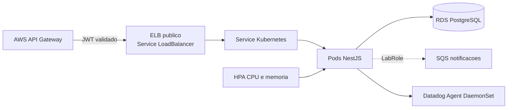

# Oficina - Fase 4 / OS Service

O runtime distribuído usa este repositório como OS Service e orquestrador da Saga, com Billing/PostgreSQL e Production/DynamoDB em repositórios independentes. O portal existente acompanha o fluxo e bloqueia a entrega sem pagamento confirmado.

- [Arquitetura, divisão dos dados e Saga](docs/fase4/arquitetura.md)
- [Configuração: onde preencher cada chave, senha e token](docs/fase4/configuracao.md)
- [Testes, evidências, roteiro do vídeo e PDF](docs/fase4/entrega.md)
- [Resultados da validação local](docs/fase4/validacao-local.md)
- [Fluxo completo pelo navegador local, com login e pagamento de demonstração](docs/fase4/teste-navegador-local.md)
- [Repositórios publicados, PRs e proteções](docs/fase4/publicacao.md)
- [Pronto para gravar: acessos, evidências e preparação](docs/entrega/pronto-para-gravar.md): OS #2 **ENTREGUE, R$175**, compensação e recuperação verificadas em 10/11/2026.
- [Datadog Fase 4 por GitHub Actions](https://github.com/christochula/oficina-infra-kubernetes/blob/feature/phase4-distributed/docs/datadog-actions.md) e [contrato/evidência dos sinais](docs/operacao/datadog.md). Ingestão dos três serviços, métricas Saga/p95 e um trace com os três serviços verificados; esse trace cobre parte do fluxo.

Quickstart: manter os três repositórios lado a lado, executar `docker compose -f compose.phase4.yml up -d --build`, `npm run test:bdd` e `npm run test:frontend:e2e`. `PHASE4_ENABLED=true` é o modo de entrega; `false` preserva a regressão histórica da Fase 3. Leia o guia antes de configurar AWS.

## Homologação e evidências da Fase 4

Snapshot de 06/11/2026, fonte implantada `3657c33`:

- [CI aprovado](https://github.com/christochula/oficina-api/actions/runs/42235917925): checks `Quality`, `Integration`, `Sonar`, `Frontend`, `BDD` e `Container` aprovados no mesmo SHA.
- [SonarCloud](https://sonarcloud.io/dashboard?id=christochula-oficina_oficina-api): cobertura **91,8%**, linhas 96,2% e branches 85,0%; quality gate aprovado. São métricas Sonar, distintas do resumo Jest local.
- [Relatório de cobertura](https://github.com/christochula/oficina-api/actions/runs/42235917925/artifacts/13511692411): artifact `os-coverage` da mesma execução CI.
- [Deploy por GitHub Actions aprovado](https://github.com/christochula/oficina-api/actions/runs/42236847066): imagem imutável do SHA `3657c33c0a8776501b641276f92832b735634aa0`, duas réplicas prontas no EKS e health público HTTP200 após o rollout.
- [Portal de homologação](https://8phthn792m.execute-api.us-east-1.amazonaws.com), [Swagger OS](https://8phthn792m.execute-api.us-east-1.amazonaws.com/api/docs) e [OpenAPI OS](https://8phthn792m.execute-api.us-east-1.amazonaws.com/api/docs-json).
- Contratos públicos no mesmo Gateway: [OpenAPI Billing](https://8phthn792m.execute-api.us-east-1.amazonaws.com/api/v1/billing/openapi.json) e [OpenAPI Production](https://8phthn792m.execute-api.us-east-1.amazonaws.com/api/v1/production/openapi.json).

Validação manual no portal em 06/11/2026: a OS de demonstração #1 passou por abertura, atribuição, diagnóstico, orçamento de R$175,00, aprovação, compensação por falta de estoque, reposição e nova Saga, execução, pagamento no Checkout Pro com contas de teste e entrega. O webhook assinado recebeu HTTP201; o estado final foi `ENTREGUE`, com pagamento `APPROVED` e `paymentConfirmed=true`.

Os endpoints foram consultados com HTTP200 em 06/11/2026. A disponibilidade da homologação depende da sessão ativa do AWS Academy; renovar as credenciais temporárias e fazer rollout pelos workflows ao iniciar outra sessão.

### Instrumentação e Datadog — 10/11/2026

- [CI push aprovado](https://github.com/christochula/oficina-api/actions/runs/42928478487) e [CI do PR aprovado](https://github.com/christochula/oficina-api/actions/runs/42928486551), fonte `af93d839a46759f449b8be61ea5a73b8341deffa`; Quality, Integration, Sonar, Frontend, BDD e Container aprovados.
- [Deploy OS aprovado](https://github.com/christochula/oficina-api/actions/runs/42929328275), fonte `af93d83`; [Billing](https://github.com/christochula/oficina-billing-service/actions/runs/42928569648), `2335`; [Production](https://github.com/christochula/oficina-production-service/actions/runs/42928627925), `7daa`.
- [Apply Datadog aprovado](https://github.com/christochula/oficina-infra-kubernetes/actions/runs/42929602706), fonte `84c6494`, e [dashboard de homologação](https://app.datadoghq.com/dashboard/u6t-x9c-awx/oficina--operao-e-observabilidade--homolog).
- [Apply dos percentis aprovado](https://github.com/christochula/oficina-infra-kubernetes/actions/runs/42932263134), fonte `917a94e`, após [plano revisado](https://github.com/christochula/oficina-infra-kubernetes/actions/runs/42931855935): nenhuma alteração AWS e duas configurações de métricas Datadog.
- Ingestão inicial em **11/11/2026 00:17:54 UTC / 10/11 21:17:54 São Paulo**: spans APM e logs dos três serviços; 3 séries HTTP e 6 séries de fila, com 3 DLQs em zero. No ensaio seguinte, consultas retornaram 7 séries Saga e p95 HTTP dos três serviços com pontos reais. Detalhes e limites em [Datadog](docs/operacao/datadog.md#evidência-verificada).

O ensaio de **10/11/2026 em São Paulo** concluiu a OS **#2**, `os06a521bf-0d80-49b5-8dd2-1a1c9c961588`, **ENTREGUE**, total **R$175**, pagamento **APPROVED** e `paymentConfirmed=true`. A Saga `57dccf1d-8f9d-4d2d-93ce-099c823d1264` foi compensada por falta de estoque; após reposição, a nova Saga `c5469a88-8b2b-4503-a146-e3db319485fd` completou a preparação, seguida de reparo, pagamento e entrega. O recurso canônico Mercado Pago confirmou valor/moeda e vendedor/comprador TEST esperados; o campo observado permaneceu `live_mode=true`.

O trace `6af3b4f30000000061b75976960c6fe6` contém spans dos três serviços para parte desse fluxo. Logs também registraram compensação, recuperação e confirmação de pagamento por webhook. Não se afirma que toda transição esteja indexada nem que toda a Saga humana forme um único trace. O histórico da OS #1 de 06/11 permanece preservado; o [guia de gravação](docs/entrega/pronto-para-gravar.md) usa a OS #2 como evidência atual.

---

A documentação abaixo preserva o histórico da Fase 3; contratos e configuração da Fase 4 estão nos links acima.

# Oficina API

Aplicação principal do Tech Challenge 3. Este repositório mantém o backend NestJS, o modelo Prisma, as migrações, a imagem OCI e o chart Helm executado no Amazon EKS. A autenticação de clientes por CPF é emitida pelo repositório `oficina-auth-serverless`; o login de operadores por e-mail e senha permanece disponível.

## Arquitetura deste repositório

> Executado no **AWS Academy Learner Lab** — ver `docs/adr/` para as decisões e limitações.



O API Gateway e as Lambdas ficam em `oficina-auth-serverless`; VPC/EKS/ECR/Datadog Agent em `oficina-infra-kubernetes`; RDS e o secret de conexão em `oficina-infra-database`. Sem ALB interno / VPC Link / IRSA / External Secrets Operator (indisponíveis no Learner Lab): o ingress é um `Service type: LoadBalancer` público e o Secret da aplicação é criado pelo pipeline a partir do Secrets Manager.

## Tecnologias

- Node.js 22, NestJS 11 e TypeScript
- Prisma ORM e PostgreSQL
- JWT/Passport e Swagger/OpenAPI
- Jest e Testcontainers
- Docker/OCI e Helm/Kubernetes
- Datadog APM (`dd-trace`), DogStatsD, logs JSON e Unified Service Tagging
- GitHub Actions (credenciais de sessão do AWS Academy)

## Execução local

Requisitos: Node.js 22, npm e Docker.

```bash
cp .env.example .env
docker compose up -d db
npm ci
npx prisma migrate deploy
npm run seed
npm run start:dev
```

A API fica em `http://localhost:3000/api`. Os endpoints de saúde são:

- `GET /api/health/live`: processo disponível.
- `GET /api/health/ready`: processo e PostgreSQL disponíveis.

O valor de `JWT_SECRET` local deve ser igual ao usado pela função serverless para validar tokens de clientes. Nunca envie `.env`, tokens, CPF, connection strings ou chaves Datadog ao Git.

## APIs e coleções

- Swagger local: `http://localhost:3000/api/docs`
- Postman: [`postman/oficina-api.postman_collection.json`](postman/oficina-api.postman_collection.json)
- Contrato da autenticação por CPF: `../oficina-auth-serverless/openapi.yaml`
- [Swagger homologação](https://8phthn792m.execute-api.us-east-1.amazonaws.com/api/docs)

O endereço publicado acima é o ambiente de homologação da Fase 4 no AWS Academy.

## Autenticação

O `JwtStrategy` aceita dois tipos de access token HS256, sempre com `iss=oficina-auth-serverless` e `aud=oficina-api`:

- `token_use=client`: emitido pela Lambda após validar CPF, cliente existente e ativo. O backend consulta novamente o cliente, aplica o papel `CLIENTE` e limita acesso às próprias ordens.
- `token_use=operator`: emitido pelo login legado para administrador, consultor técnico ou mecânico.

Tokens expirados, clientes/usuários inativos e assinatura, issuer ou audience inválidos são rejeitados. CPF não é incluído no JWT nem nos logs.

## Observabilidade Datadog

Para operar a **Fase 4**, seguir o [workflow da infraestrutura](https://github.com/christochula/oficina-infra-kubernetes/blob/feature/phase4-distributed/docs/datadog-actions.md), Environment `homolog`, secret `oficina/datadog` e Gateway HTTPS como `API_BASE_URL`. Abaixo permanece a referência histórica; o [registro atual](docs/operacao/datadog.md) comprova sinais dos três serviços, gauges SQS/DLQ, Saga/p95 e um trace com os três serviços em parte do ensaio da OS #2. A integração AWS cross-account não está disponível no Academy.

O processo inicia o tracer antes do Nest (`node --require dd-trace/init`). Todos os logs são JSON e incluem `correlation_id`, `dd.trace_id` e `dd.span_id` quando houver span ativo. O header `X-Correlation-Id` é validado ou criado e devolvido ao chamador.

Métricas DogStatsD emitidas:

| Métrica | Finalidade |
|---|---|
| `oficina.api.request.duration_ms` | Distribuição de latência HTTP |
| `oficina.service_orders.created` | Volume de ordens abertas |
| `oficina.service_orders.status_transition` | Transições por status |
| `oficina.service_orders.status_duration_ms` | Diagnóstico e execução na Fase 4; finalização é referência do fluxo legado |
| `oficina.service_orders.processing_errors` | Falhas no processamento de ordens |
| `oficina.integrations.errors` | Erros de webhook/integrações |

O histórico relacional da ordem persiste `statusAnterior`, `statusNovo` e timestamp. A aplicação calcula a duração ao deixar um status e a envia como distribuição, evitando estimativas com base apenas no estado atual.

## Qualidade

```bash
npm run format:check
npm run lint
npm run test:cov -- --runInBand
npm run test:e2e
npm run build
docker build -t oficina-api:local .
```

A suíte herdada e ampliada contém testes unitários e E2E. O workflow `CI` executa formatação, lint, cobertura, build, E2E e build do container em Pull Requests.

## Deploy automático

`.github/workflows/deploy.yml` roda a cada merge em `main` (e via *workflow_dispatch*): build da imagem → ECR (`oficina-homolog-api:<sha>`), cria o Secret `oficina-api` a partir do AWS Secrets Manager, `helm upgrade --install --atomic --wait`. O chart roda `prisma migrate deploy` (hook), probes HTTP, PDB, HPA 2–8 réplicas e `Service type: LoadBalancer`.

**GitHub Secrets** (renovar a cada sessão do Learner Lab, ~4h): `AWS_ACCESS_KEY_ID`, `AWS_SECRET_ACCESS_KEY`, `AWS_SESSION_TOKEN`. Opcionais: `ADMIN_SEED_PASSWORD`, `ORCAMENTO_WEBHOOK_TOKEN`.

**GitHub Variables** (após os outros repos subirem): `NOTIFICATION_QUEUE_URL` (output de `oficina-auth-serverless`), `DATABASE_SECRET_ID` (default `oficina/homolog/database/connection`), `JWT_SECRET_ID` (default `oficina/homolog/jwt`), `DD_ENABLED`, `DD_SITE`, `CORS_ORIGIN`.

`ci.yml` (PR/push): formatação, lint, cobertura, build, E2E, `helm lint`/`template`, build do container (sem push) — não usa AWS.

## Proteção do repositório

`.github/settings.yml` descreve `main` e `homolog` sem push direto, com Pull Request, uma aprovação e checks `Quality`, `E2E` e `Container`. Aplicar essas regras no GitHub e confirmar o convite do usuário `soat-architecture`; arquivos locais não conseguem comprovar esse estado externo.

## Documentação da entrega

Toda a documentação compartilhada está centralizada em [`docs/`](docs/README.md): diagramas, RFCs, ADRs, modelo ER, runbooks, matriz de requisitos, roteiro do vídeo e conteúdo-base do PDF final. Os demais repositórios mantêm apenas o `README.md` obrigatório e apontam para esta pasta.

## Licença

MIT. Consulte [LICENSE](LICENSE).

