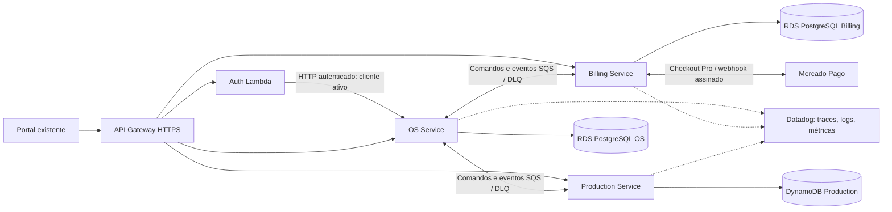

# Fase 4: arquitetura e Saga

O OS Service mantém atendimento, clientes, veículos, usuários, catálogo, histórico e estado da Saga. Billing é o proprietário do orçamento e pagamento. Production é o proprietário do diagnóstico, fila, peças e execução. Cada serviço tem banco, imagem, manifesto, Terraform/state e pipeline próprios. O EKS e o Datadog são compartilhados.

## Propriedade e compatibilidade

`PHASE4_ENABLED=true` ativa exclusivamente os controllers distribuídos de OS; os antigos controllers de orçamento, produção e webhook de status não são registrados. As rotas legadas do portal encaminham operações por HTTP ao serviço dono dos dados, com o JWT do usuário. O detalhe agrega snapshots via APIs; o banco OS não participa de transações no banco Billing ou DynamoDB.

`PHASE4_ENABLED=false` é a configuração de regressão da Fase 3. Ela preserva os testes anteriores e não deve ser usada na entrega da Fase 4. As migrações anteriores são mantidas para preservar o histórico: tabelas legadas de orçamento/estoque presentes no schema anterior não são utilizadas pelo runtime distribuído.

## Por que orquestração

O fluxo tem decisões humanas e várias etapas reversíveis antes do reparo. Um orquestrador persistente no OS Service torna cada avanço e compensação consultável e facilita a demonstração de falhas sem adicionar um quarto serviço de negócio.

Preparação: `PrepareApprovedBudget` → `BudgetPrepared` → `ReserveExecution` → `ExecutionReserved` → `ConfirmExecution` → `ExecutionReady`.

Compensação: falha técnica → `CancelExecutionReservation` → `ExecutionCancelled` → `ReleaseBudgetPreparation` → `BudgetReleased`. A OS permanece aprovada, com Saga `COMPENSATED`. A nova tentativa usa outro `sagaId`; tombstones impedem que comandos antigos reabram reservas canceladas.

O início físico é a fronteira de compensação. Reservas são liberadas somente se o trabalho ainda não começou. Se uma execução já começou, a Saga exige reconciliação/intervenção. Um reparo concluído não é apagado e uma falha de cobrança não devolve estoque consumido.

Conclusão: `ProductionCompleted` → `AGUARDANDO_PAGAMENTO` → `CreatePayment`. O Billing confirma assinatura e consulta o recurso no Mercado Pago, validando referência, valor e moeda. Só `PaymentConfirmed` válido libera `PRONTA_PARA_ENTREGA`; a entrega exige essa condição também na API.

## Garantias e recuperação

- PostgreSQL usa locks por OS, inbox e outbox na mesma transação. DynamoDB usa `TransactWriteItems`, revisões condicionais e registros duráveis de deduplicação/reserva.
- Publicação usa outbox persistente e retry; consumidores só removem uma mensagem SQS após persistir o resultado. SQS usa DLQ após tentativas malsucedidas.
- O envelope inclui `messageId`, `type`, `version`, `sagaId`, `osId`, `filialId`, `correlationId`, `occurredAt` e `traceparent` quando disponível.
- Duplicatas são esperadas. Callbacks de pagamento e mensagens repetidas não podem duplicar consumo ou cobrança. Timeout do provedor preserva resultado desconhecido e exige reconciliação antes de outro POST financeiro.
- Timeouts técnicos não se aplicam às esperas humanas por aprovação e pagamento. Falhas de compensação ficam visíveis em `MANUAL_ATTENTION`.
- O estado da Saga é persistido no OS; reiniciar um pod retoma inbox/outbox e prazos pendentes.

Referências: [Saga](https://docs.aws.amazon.com/prescriptive-guidance/latest/cloud-design-patterns/saga-patterns.html), [outbox](https://docs.aws.amazon.com/prescriptive-guidance/latest/cloud-design-patterns/transactional-outbox.html), [webhooks Mercado Pago](https://www.mercadopago.com.br/developers/pt/docs/checkout-pro-preferences/payment-notifications).
